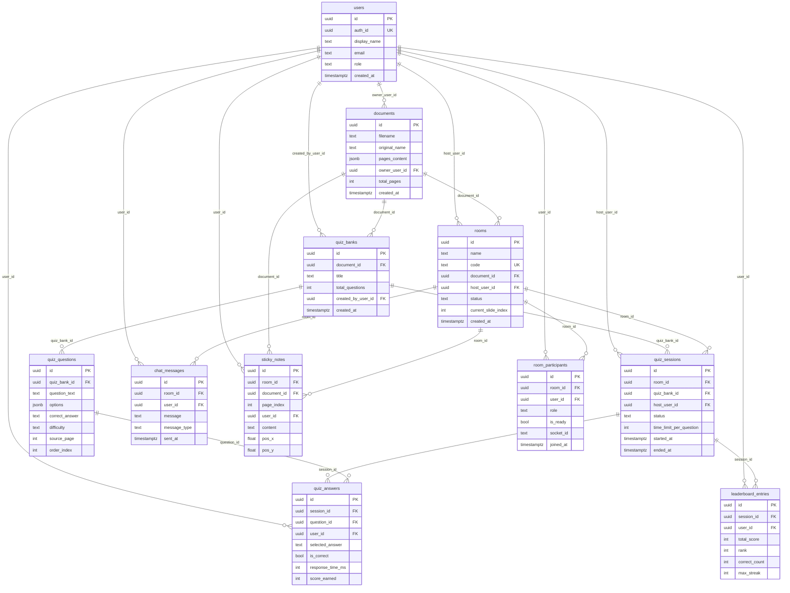

# DATABASE SCHEMA — Real-time Collaborative AI Study Platform

> **Database:** Supabase (PostgreSQL)  
> **Storage:** Supabase Storage  
> **Cập nhật lần cuối:** 2026-10-09  
> **Trạng thái ký hiệu:** ✅ Đã triển khai · ⚠️ Cần bổ sung cột · ❌ Chưa tạo bảng

---

## 📊 TỔNG QUAN

| # | Tên Bảng | Trạng thái | Mô tả |
|---|----------|------------|-------|
| 1 | `users` | ❌ Chưa tạo | Người dùng / người chơi |
| 2 | `rooms` | ✅ Đã có (thiếu cột) | Phòng học |
| 3 | `documents` | ✅ Đã có | Tài liệu PDF/PPTX |
| 4 | `quiz_banks` | ❌ Chưa tạo | Ngân hàng bộ câu hỏi AI sinh |
| 5 | `quiz_questions` | ❌ Chưa tạo | Từng câu hỏi trong bộ quiz |
| 6 | `quiz_sessions` | ❌ Chưa tạo | Một lượt thi đấu trong phòng |
| 7 | `quiz_answers` | ❌ Chưa tạo | Đáp án từng người chơi |
| 8 | `leaderboard_entries` | ❌ Chưa tạo | Điểm số & xếp hạng |
| 9 | `chat_messages` | ❌ Chưa tạo | Lịch sử chat phòng học |
| 10 | `sticky_notes` | ❌ Chưa tạo | Ghi chú dán trên slide |
| 11 | `room_participants` | ❌ Chưa tạo | Thành viên trong phòng |

**Storage Bucket:** `slides` ✅ Đã có — lưu file gốc PDF/PPTX

---

## 🗂️ CHI TIẾT TỪNG BẢNG

---

### 1. `users` ❌ Chưa tạo

> Quản lý tài khoản người dùng. Có thể dùng Supabase Auth (`auth.users`) và extend thêm bảng `users` cho metadata.

| Cột | Kiểu | Ràng buộc | Mô tả |
|-----|------|-----------|-------|
| `id` | `uuid` | PK, DEFAULT `gen_random_uuid()` | ID người dùng |
| `auth_id` | `uuid` | UNIQUE, FK → `auth.users.id` | Liên kết Supabase Auth |
| `display_name` | `text` | NOT NULL | Tên hiển thị |
| `avatar_url` | `text` | NULLABLE | Đường dẫn ảnh đại diện |
| `email` | `text` | UNIQUE, NOT NULL | Email |
| `role` | `text` | DEFAULT `'student'` | Vai trò: `host` / `student` |
| `created_at` | `timestamptz` | DEFAULT `now()` | Thời điểm tạo tài khoản |

**SQL tạo bảng:**
```sql
CREATE TABLE users (
  id          uuid PRIMARY KEY DEFAULT gen_random_uuid(),
  auth_id     uuid UNIQUE REFERENCES auth.users(id) ON DELETE CASCADE,
  display_name text NOT NULL,
  avatar_url  text,
  email       text UNIQUE NOT NULL,
  role        text DEFAULT 'student' CHECK (role IN ('host', 'student')),
  created_at  timestamptz DEFAULT now()
);
```

---

### 2. `rooms` ✅ Đã có — ⚠️ Cần bổ sung cột

> Phòng học được tạo bởi Host, thành viên tham gia qua mã 6 số.

| Cột | Kiểu | Ràng buộc | Trạng thái | Mô tả |
|-----|------|-----------|-----------|-------|
| `id` | `uuid` | PK | ✅ Có | ID phòng |
| `name` | `text` | NOT NULL | ✅ Có | Tên phòng |
| `code` | `text` | UNIQUE, NOT NULL | ✅ Có | Mã phòng 6 số |
| `document_id` | `uuid` | FK → `documents.id` | ✅ Có | Tài liệu đang trình chiếu |
| `host_user_id` | `uuid` | FK → `users.id` | ❌ Thiếu | Chủ phòng |
| `status` | `text` | DEFAULT `'waiting'` | ❌ Thiếu | Trạng thái: `waiting` / `presenting` / `quiz` / `ended` |
| `current_slide_index` | `int` | DEFAULT `0` | ❌ Thiếu | Trang slide hiện tại (đồng bộ) |
| `invite_link` | `text` | NULLABLE | ❌ Thiếu | Đường dẫn mời nhanh |
| `created_at` | `timestamptz` | DEFAULT `now()` | ✅ Có | Thời điểm tạo phòng |
| `ended_at` | `timestamptz` | NULLABLE | ❌ Thiếu | Thời điểm đóng phòng |

**SQL bổ sung cột còn thiếu:**
```sql
ALTER TABLE rooms
  ADD COLUMN IF NOT EXISTS host_user_id    uuid REFERENCES users(id),
  ADD COLUMN IF NOT EXISTS status          text DEFAULT 'waiting'
                                            CHECK (status IN ('waiting','presenting','quiz','ended')),
  ADD COLUMN IF NOT EXISTS current_slide_index int DEFAULT 0,
  ADD COLUMN IF NOT EXISTS invite_link     text,
  ADD COLUMN IF NOT EXISTS ended_at        timestamptz;
```

---

### 3. `documents` ✅ Đã có

> Lưu metadata và nội dung text trích xuất từ file PDF/PPTX tải lên.

| Cột | Kiểu | Ràng buộc | Trạng thái | Mô tả |
|-----|------|-----------|-----------|-------|
| `id` | `uuid` | PK | ✅ Có | ID tài liệu |
| `filename` | `text` | NOT NULL | ✅ Có | Tên file lưu trên Storage (có timestamp) |
| `original_name` | `text` | NOT NULL | ✅ Có | Tên gốc người dùng đặt |
| `pages_content` | `jsonb` | NOT NULL | ✅ Có | Mảng text từng trang `["trang1...", "trang2..."]` |
| `owner_user_id` | `uuid` | FK → `users.id` | ❌ Thiếu | Người tải lên |
| `total_pages` | `int` | NULLABLE | ❌ Thiếu | Tổng số trang |
| `storage_path` | `text` | NULLABLE | ❌ Thiếu | Đường dẫn đầy đủ trong Supabase Storage |
| `created_at` | `timestamptz` | DEFAULT `now()` | ✅ Có | Thời điểm upload |

**SQL bổ sung cột còn thiếu:**
```sql
ALTER TABLE documents
  ADD COLUMN IF NOT EXISTS owner_user_id uuid REFERENCES users(id),
  ADD COLUMN IF NOT EXISTS total_pages   int,
  ADD COLUMN IF NOT EXISTS storage_path  text;
```

---

### 4. `quiz_banks` ❌ Chưa tạo

> Một bộ câu hỏi hoàn chỉnh được AI sinh ra từ một tài liệu.

| Cột | Kiểu | Ràng buộc | Mô tả |
|-----|------|-----------|-------|
| `id` | `uuid` | PK | ID bộ quiz |
| `document_id` | `uuid` | FK → `documents.id`, NOT NULL | Sinh từ tài liệu nào |
| `title` | `text` | NULLABLE | Tiêu đề bộ câu hỏi |
| `total_questions` | `int` | DEFAULT `0` | Số câu hỏi |
| `created_by_user_id` | `uuid` | FK → `users.id` | Người tạo |
| `created_at` | `timestamptz` | DEFAULT `now()` | Thời điểm tạo |

**SQL tạo bảng:**
```sql
CREATE TABLE quiz_banks (
  id                  uuid PRIMARY KEY DEFAULT gen_random_uuid(),
  document_id         uuid NOT NULL REFERENCES documents(id) ON DELETE CASCADE,
  title               text,
  total_questions     int DEFAULT 0,
  created_by_user_id  uuid REFERENCES users(id),
  created_at          timestamptz DEFAULT now()
);
```

---

### 5. `quiz_questions` ❌ Chưa tạo

> Từng câu hỏi trong một bộ quiz. AI sinh ra và lưu vào đây.

| Cột | Kiểu | Ràng buộc | Mô tả |
|-----|------|-----------|-------|
| `id` | `uuid` | PK | ID câu hỏi |
| `quiz_bank_id` | `uuid` | FK → `quiz_banks.id`, NOT NULL | Thuộc bộ quiz nào |
| `question_text` | `text` | NOT NULL | Nội dung câu hỏi |
| `options` | `jsonb` | NOT NULL | Mảng các lựa chọn: `[{"key":"A","text":"..."},...]` |
| `correct_answer` | `text` | NOT NULL | Đáp án đúng (key: `"A"`, `"B"`...) |
| `explanation` | `text` | NULLABLE | Giải thích tại sao đúng/sai |
| `difficulty` | `text` | DEFAULT `'medium'` | Độ khó: `easy` / `medium` / `hard` |
| `source_page` | `int` | NULLABLE | Số trang slide nguồn tham chiếu |
| `question_type` | `text` | DEFAULT `'single'` | Loại: `single` / `multiple` / `true_false` |
| `order_index` | `int` | DEFAULT `0` | Thứ tự câu hỏi trong bộ |

**SQL tạo bảng:**
```sql
CREATE TABLE quiz_questions (
  id            uuid PRIMARY KEY DEFAULT gen_random_uuid(),
  quiz_bank_id  uuid NOT NULL REFERENCES quiz_banks(id) ON DELETE CASCADE,
  question_text text NOT NULL,
  options       jsonb NOT NULL,
  correct_answer text NOT NULL,
  explanation   text,
  difficulty    text DEFAULT 'medium' CHECK (difficulty IN ('easy','medium','hard')),
  source_page   int,
  question_type text DEFAULT 'single' CHECK (question_type IN ('single','multiple','true_false')),
  order_index   int DEFAULT 0
);
```

---

### 6. `quiz_sessions` ❌ Chưa tạo

> Một phiên thi đấu được kích hoạt bởi Host trong phòng học.

| Cột | Kiểu | Ràng buộc | Mô tả |
|-----|------|-----------|-------|
| `id` | `uuid` | PK | ID phiên thi |
| `room_id` | `uuid` | FK → `rooms.id`, NOT NULL | Thuộc phòng nào |
| `quiz_bank_id` | `uuid` | FK → `quiz_banks.id`, NOT NULL | Dùng bộ câu hỏi nào |
| `host_user_id` | `uuid` | FK → `users.id` | Host kích hoạt |
| `status` | `text` | DEFAULT `'waiting'` | Trạng thái: `waiting` / `active` / `finished` |
| `time_limit_per_question` | `int` | DEFAULT `15` | Giới hạn thời gian/câu (giây) |
| `current_question_index` | `int` | DEFAULT `0` | Câu hỏi đang diễn ra |
| `started_at` | `timestamptz` | NULLABLE | Thời điểm bắt đầu thi |
| `ended_at` | `timestamptz` | NULLABLE | Thời điểm kết thúc thi |
| `created_at` | `timestamptz` | DEFAULT `now()` | Thời điểm tạo session |

**SQL tạo bảng:**
```sql
CREATE TABLE quiz_sessions (
  id                       uuid PRIMARY KEY DEFAULT gen_random_uuid(),
  room_id                  uuid NOT NULL REFERENCES rooms(id) ON DELETE CASCADE,
  quiz_bank_id             uuid NOT NULL REFERENCES quiz_banks(id),
  host_user_id             uuid REFERENCES users(id),
  status                   text DEFAULT 'waiting'
                            CHECK (status IN ('waiting','active','finished')),
  time_limit_per_question  int DEFAULT 15,
  current_question_index   int DEFAULT 0,
  started_at               timestamptz,
  ended_at                 timestamptz,
  created_at               timestamptz DEFAULT now()
);
```

---

### 7. `quiz_answers` ❌ Chưa tạo

> Lưu đáp án của từng người chơi cho từng câu hỏi trong một phiên thi.

| Cột | Kiểu | Ràng buộc | Mô tả |
|-----|------|-----------|-------|
| `id` | `uuid` | PK | ID đáp án |
| `session_id` | `uuid` | FK → `quiz_sessions.id`, NOT NULL | Thuộc phiên thi nào |
| `question_id` | `uuid` | FK → `quiz_questions.id`, NOT NULL | Câu hỏi nào |
| `user_id` | `uuid` | FK → `users.id`, NOT NULL | Người chơi |
| `selected_answer` | `text` | NOT NULL | Đáp án chọn (key: `"A"`, `"B"`...) |
| `is_correct` | `bool` | NOT NULL | Đúng hay sai |
| `response_time_ms` | `int` | NOT NULL | Thời gian phản hồi (ms) |
| `score_earned` | `int` | DEFAULT `0` | Điểm kiếm được câu này |
| `streak_bonus` | `int` | DEFAULT `0` | Điểm thưởng chuỗi thắng |
| `answered_at` | `timestamptz` | DEFAULT `now()` | Thời điểm nộp đáp án |

**SQL tạo bảng:**
```sql
CREATE TABLE quiz_answers (
  id              uuid PRIMARY KEY DEFAULT gen_random_uuid(),
  session_id      uuid NOT NULL REFERENCES quiz_sessions(id) ON DELETE CASCADE,
  question_id     uuid NOT NULL REFERENCES quiz_questions(id),
  user_id         uuid NOT NULL REFERENCES users(id),
  selected_answer text NOT NULL,
  is_correct      bool NOT NULL,
  response_time_ms int NOT NULL,
  score_earned    int DEFAULT 0,
  streak_bonus    int DEFAULT 0,
  answered_at     timestamptz DEFAULT now(),
  UNIQUE (session_id, question_id, user_id)
);
```

---

### 8. `leaderboard_entries` ❌ Chưa tạo

> Tổng điểm và xếp hạng cuối phiên thi của từng người chơi.

| Cột | Kiểu | Ràng buộc | Mô tả |
|-----|------|-----------|-------|
| `id` | `uuid` | PK | ID entry |
| `session_id` | `uuid` | FK → `quiz_sessions.id`, NOT NULL | Phiên thi |
| `user_id` | `uuid` | FK → `users.id`, NOT NULL | Người chơi |
| `display_name` | `text` | NOT NULL | Tên hiển thị (snapshot tránh join) |
| `total_score` | `int` | DEFAULT `0` | Tổng điểm |
| `correct_count` | `int` | DEFAULT `0` | Số câu đúng |
| `wrong_count` | `int` | DEFAULT `0` | Số câu sai |
| `avg_response_ms` | `int` | DEFAULT `0` | Thời gian phản hồi trung bình |
| `max_streak` | `int` | DEFAULT `0` | Chuỗi thắng dài nhất |
| `rank` | `int` | NULLABLE | Xếp hạng cuối cùng |
| `created_at` | `timestamptz` | DEFAULT `now()` | Thời điểm ghi nhận |

**SQL tạo bảng:**
```sql
CREATE TABLE leaderboard_entries (
  id               uuid PRIMARY KEY DEFAULT gen_random_uuid(),
  session_id       uuid NOT NULL REFERENCES quiz_sessions(id) ON DELETE CASCADE,
  user_id          uuid NOT NULL REFERENCES users(id),
  display_name     text NOT NULL,
  total_score      int DEFAULT 0,
  correct_count    int DEFAULT 0,
  wrong_count      int DEFAULT 0,
  avg_response_ms  int DEFAULT 0,
  max_streak       int DEFAULT 0,
  rank             int,
  created_at       timestamptz DEFAULT now(),
  UNIQUE (session_id, user_id)
);
```

---

### 9. `chat_messages` ❌ Chưa tạo

> Lịch sử chat của phòng học (persistent, không mất khi refresh).

| Cột | Kiểu | Ràng buộc | Mô tả |
|-----|------|-----------|-------|
| `id` | `uuid` | PK | ID tin nhắn |
| `room_id` | `uuid` | FK → `rooms.id`, NOT NULL | Thuộc phòng nào |
| `user_id` | `uuid` | FK → `users.id` | Người gửi (NULL = system message) |
| `display_name` | `text` | NOT NULL | Tên hiển thị người gửi |
| `message` | `text` | NOT NULL | Nội dung tin nhắn |
| `message_type` | `text` | DEFAULT `'text'` | Loại: `text` / `emoji` / `system` |
| `sent_at` | `timestamptz` | DEFAULT `now()` | Thời điểm gửi |

**SQL tạo bảng:**
```sql
CREATE TABLE chat_messages (
  id           uuid PRIMARY KEY DEFAULT gen_random_uuid(),
  room_id      uuid NOT NULL REFERENCES rooms(id) ON DELETE CASCADE,
  user_id      uuid REFERENCES users(id) ON DELETE SET NULL,
  display_name text NOT NULL,
  message      text NOT NULL,
  message_type text DEFAULT 'text' CHECK (message_type IN ('text','emoji','system')),
  sent_at      timestamptz DEFAULT now()
);
CREATE INDEX idx_chat_messages_room_id ON chat_messages(room_id, sent_at DESC);
```

---

### 10. `sticky_notes` ❌ Chưa tạo

> Ghi chú dán trên slide, persistent (không mất khi người dùng refresh).

| Cột | Kiểu | Ràng buộc | Mô tả |
|-----|------|-----------|-------|
| `id` | `uuid` | PK | ID sticky note |
| `room_id` | `uuid` | FK → `rooms.id`, NOT NULL | Thuộc phòng nào |
| `document_id` | `uuid` | FK → `documents.id`, NOT NULL | Thuộc tài liệu nào |
| `page_index` | `int` | NOT NULL | Trang slide gắn note |
| `user_id` | `uuid` | FK → `users.id` | Người tạo note |
| `content` | `text` | NOT NULL | Nội dung ghi chú |
| `color` | `text` | DEFAULT `'#FEFF9C'` | Màu sticky note (hex) |
| `pos_x` | `float` | DEFAULT `0` | Vị trí X (% chiều rộng slide) |
| `pos_y` | `float` | DEFAULT `0` | Vị trí Y (% chiều cao slide) |
| `created_at` | `timestamptz` | DEFAULT `now()` | Thời điểm tạo |
| `updated_at` | `timestamptz` | DEFAULT `now()` | Cập nhật lần cuối |

**SQL tạo bảng:**
```sql
CREATE TABLE sticky_notes (
  id          uuid PRIMARY KEY DEFAULT gen_random_uuid(),
  room_id     uuid NOT NULL REFERENCES rooms(id) ON DELETE CASCADE,
  document_id uuid NOT NULL REFERENCES documents(id),
  page_index  int NOT NULL,
  user_id     uuid REFERENCES users(id) ON DELETE SET NULL,
  content     text NOT NULL,
  color       text DEFAULT '#FEFF9C',
  pos_x       float DEFAULT 0,
  pos_y       float DEFAULT 0,
  created_at  timestamptz DEFAULT now(),
  updated_at  timestamptz DEFAULT now()
);
```

---

### 11. `room_participants` ❌ Chưa tạo

> Danh sách thành viên đang có mặt trong phòng (online presence).

| Cột | Kiểu | Ràng buộc | Mô tả |
|-----|------|-----------|-------|
| `id` | `uuid` | PK | ID entry |
| `room_id` | `uuid` | FK → `rooms.id`, NOT NULL | Phòng học |
| `user_id` | `uuid` | FK → `users.id`, NOT NULL | Người chơi |
| `display_name` | `text` | NOT NULL | Tên hiển thị |
| `role` | `text` | DEFAULT `'viewer'` | Vai trò: `host` / `viewer` |
| `is_ready` | `bool` | DEFAULT `false` | Trạng thái sẵn sàng (phòng chờ quiz) |
| `socket_id` | `text` | NULLABLE | Socket ID hiện tại (thay đổi mỗi kết nối) |
| `joined_at` | `timestamptz` | DEFAULT `now()` | Thời điểm vào phòng |
| `left_at` | `timestamptz` | NULLABLE | Thời điểm rời phòng |

**SQL tạo bảng:**
```sql
CREATE TABLE room_participants (
  id           uuid PRIMARY KEY DEFAULT gen_random_uuid(),
  room_id      uuid NOT NULL REFERENCES rooms(id) ON DELETE CASCADE,
  user_id      uuid NOT NULL REFERENCES users(id),
  display_name text NOT NULL,
  role         text DEFAULT 'viewer' CHECK (role IN ('host','viewer')),
  is_ready     bool DEFAULT false,
  socket_id    text,
  joined_at    timestamptz DEFAULT now(),
  left_at      timestamptz,
  UNIQUE (room_id, user_id)
);
```

---

## 🔗 SƠ ĐỒ QUAN HỆ (ERD)



---

## 📈 TIẾN ĐỘ TRIỂN KHAI DATABASE

```
Tổng số bảng cần có: 11
✅ Đã có đầy đủ :  1 bảng  (documents)
⚠️ Có nhưng thiếu:  1 bảng  (rooms — cần thêm 5 cột)
❌ Chưa tạo      :  9 bảng  (users, quiz_banks, quiz_questions, quiz_sessions,
                              quiz_answers, leaderboard_entries, chat_messages,
                              sticky_notes, room_participants)

Tiến độ: ██░░░░░░░░ ~15%
```

---

## 🚦 ƯU TIÊN TRIỂN KHAI

| Ưu tiên | Bảng | Lý do |
|---------|------|-------|
| 🔴 Cao | `users` | Mọi bảng khác phụ thuộc vào đây |
| 🔴 Cao | `room_participants` | Cần để hiển thị danh sách online |
| 🟠 Trung bình | `quiz_banks` + `quiz_questions` | Lưu quiz AI sinh ra thay vì chỉ trả về tạm |
| 🟠 Trung bình | `quiz_sessions` + `quiz_answers` + `leaderboard_entries` | Persistent kết quả thi đấu |
| 🟡 Thấp | `chat_messages` | Chat hiện hoạt động qua Socket, chưa cần lưu ngay |
| 🟡 Thấp | `sticky_notes` | Persistent note (nice to have) |

---

## 📝 GHI CHÚ

- **Supabase Auth:** Nên dùng `auth.users` tích hợp sẵn + extend bảng `users` riêng cho metadata.
- **RLS (Row Level Security):** Hiện tại đang bypass bằng `Service Role Key`. Khi có `users`, cần bật RLS để bảo vệ dữ liệu theo từng người dùng.
- **`pages_content` (JSONB):** Phù hợp cho MVP. Nếu tài liệu lớn (>100 trang), nên tách thành bảng `document_pages` riêng để query hiệu quả hơn.
- **Supabase Storage bucket `slides`:** Đã hoạt động, lưu file gốc PDF/PPTX. Cần thêm cột `storage_path` vào bảng `documents` để liên kết.
